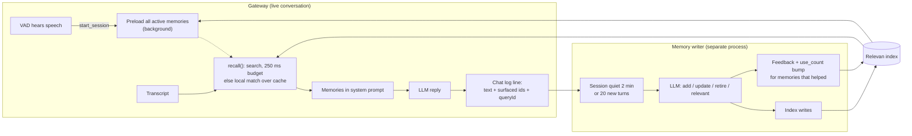

# Haru's long-term memory: design and lessons

Haru is a voice assistant: a microphone and speaker on a desk, with a GPU backend doing speech-to-text,
an LLM conversation, and text-to-speech. This document covers how it remembers things across
conversations, and what we learned building it. Memories are stored in a
[Relevan](https://relevan.dev) search index; the patterns should carry over to any search-backed store.

Code: `backend/services/gateway/haru_gateway/` — `memory.py` (read side), `memory_writer.py`
(write side), `chatlog.py` (the log between them), `relevan.py` (API client).

## The one rule: memory never delays a reply

Speech-to-speech latency is the product. End of speech to Haru talking is about 1.7 s, and memory gets
**250 ms** of that at most. Everything below follows from that budget:

- Reading memories happens on the hot path, so it has a hard deadline and a local fallback.
- Writing memories happens off the hot path entirely, in a separate process, minutes later.
- The two sides only share a file: an append-only chat log.



## The memory document

Each memory is one short, standalone sentence about the user, plus fields for ranking and lifecycle:

```json
{
  "id": "mem-3f2a9c...",
  "text": "The user's wife's birthday is June 3.",
  "subject": "wife birthday",
  "kind": "event",
  "tags": ["wife", "birthday"],
  "importance": 4,
  "person": "household",
  "status": "active",
  "use_count": 2,
  "created_at": "2026-09-30T19:12:04Z",
  "updated_at": "2026-09-30T19:12:04Z",
  "last_used_at": "2026-10-02T08:40:11Z",
  "source": "<conversation session id>"
}
```

- `kind`: fact, preference, person, event, plan, project, interest or finding.
- `importance`: 5 is core identity (their name, family), 4 is dates, plans and active projects,
  3 is preferences and interests, 2 is findings and details, 1 is trivia.
- `status`: `active` or `retired`. Retiring is a soft delete, and searches filter on `status: active`.
- `person`: always `household` for now. Haru can't tell voices apart yet, so a memory can't be
  attributed to a specific person.
- `use_count` / `last_used_at`: bumped when a memory demonstrably helped. Intended as ranking signals.

## Read side: recall during a conversation

1. **Preload early.** A memory session starts when the voice-activity detector hears speech, before
   speech-to-text has even finished. All active memories are listed from Relevan (its documents endpoint,
   not a search) into a per-session cache in the background, which covers the first turn's 300–800 ms of
   transcription time. This cache only exists as the fallback for step 3.
2. **Search each turn, with a deadline.** `recall()` sends a search built from the user's words and waits
   at most 250 ms, sharing that budget with the preload if it's still running.
3. **Fall back locally.** If the search is late or fails, recall ranks the session cache by word overlap
   with the turn plus a little weight for importance. A late search still completes into the cache, so
   later turns benefit from it.
4. **Merge.** Search hits come first, then local matches fill up to 10 memories.
5. **Inject.** The memories go into the system prompt under a short header:
   *"What you remember from earlier conversations (may be out of date; use it only when it's relevant,
   and don't recite it unprompted)"*, each with a `[noted YYYY-MM-DD]` date.
6. **Record.** The chat log stores which memory ids were surfaced on each user turn, along with the
   search's `queryId` and `sessionId`. The writer uses those later for feedback.

The cache is dropped when the conversation resets (15 idle minutes).

## Write side: the memory writer

A separate process polls the chat log every 20 s. It processes a session once it has been quiet for
2 minutes or has piled up 20 unprocessed turns. For each batch it:

1. Gathers the **new turns**, plus up to 6 earlier turns as context that is explicitly marked as
   "already processed, don't extract from it".
2. Gathers up to 40 **existing memories** related to those turns: everything that was surfaced during them,
   then by word overlap and importance.
3. Asks the LLM (reasoning effort `medium`) for JSON operations:
   ```json
   {"add": [...], "update": [{"id": "...", ...}], "retire": [{"id": "...", "reason": "..."}],
    "relevant": ["mem-..."]}
   ```
4. Validates every operation (known kind, importance clamped to 1–5, length limits, update and retire only
   for ids it was shown) and writes them to the index.
5. For each memory in `relevant`, sends `llm_judgment` feedback against every search in those turns that
   surfaced it (with its position), and bumps `use_count` / `last_used_at`.
6. Checkpoints how many log entries of that session are done, so a restart never redoes or skips turns.
   A failed batch isn't checkpointed and gets retried on the next pass.

## Lessons

**Search on content words, not whole utterances.** Spoken input is long and full of filler. "I am feeling
peckish, any snack ideas for me?" scored 0 against the index, while "snack" alone scored 3.5. Recall now
strips stop words (including "hey", "haru", "please", "tell") and searches what's left. A better fix may be
on the search side (handling conversational queries), so this is deliberately simple.

**Give every memory a real subject.** The model kept setting `subject` to "user", which is true of every
memory and useless for search. The prompt now forbids it, and the writer replaces "user" / "household" /
empty subjects with the first tags. A subject like "dog Biscuit" or "work schedule" is what a later query
actually matches.

**Write memories as standalone third-person sentences.** "The user's wife's birthday is June 3." reads
correctly in a prompt months later, with no conversation around it, and keeps proper names exactly as heard.

**Date anything time-sensitive in the text itself.** Projects, interests and findings go stale. The writer
gets the current date and writes "As of September 30, 2026, the user is evaluating…", and the prompt
shows each memory's date. The model can then judge staleness without any extra machinery.

**Lookups reveal interests.** "Look up what the Google Developer Program includes" means "the user is
evaluating the Google Developer Program". Remembering the intent behind a question, plus the key finding
Haru reported, turned out to be more useful than remembering facts the user stated outright.

**Say what not to remember.** The microphone is always on. The extraction prompt explicitly excludes
small talk, passing states ("I'm hungry"), one-off trivia, Haru's own suggestions the user didn't take up,
garbled transcription, and speech that sounds like a TV or other people not talking to Haru. Without
that list, the index fills with noise.

**Let the writer update and retire, not just add.** Showing the model the related existing memories with
their ids lets it update ("moved to Denver") and retire, instead of piling up contradictions. Retiring is a
soft status change, so nothing is lost.

**Close the loop with feedback, judged after the fact.** We don't know at recall time whether a memory
helped. The writer does: it sees the whole exchange. Its `relevant` list becomes search feedback tied to the
original `queryId` and position, which gives the index real relevance signal from actual use.

**Treat the store's latency as variable, by design.** With a serverless database behind the search API,
the first request after an idle period can take seconds (a cold start). With the 250 ms budget and the local
fallback, a cold store degrades recall quality for a turn rather than delaying the reply: Haru still answers
on time, from the cache. The preload logs a timeout when this happens.

**Keep extraction out of process.** Extraction is a slow, failure-prone LLM call. Running it in a separate
process that reads the chat log means a slow model, a bad JSON reply or a store outage can't touch a live
conversation. It also makes the chat log a replayable source of truth: you can delete the index and rebuild
it from the log.

**Validate everything the model returns.** Local models make occasional malformed calls. The writer strips
code fences, finds the outer JSON object, ignores unknown ids, clamps fields, and drops memories over 400
characters rather than trusting the output.

## Known limits and next steps

- **The preload lists the whole index.** The per-turn recall is a Relevan search, but the session preload
  (the local fallback cache) pages through Relevan's documents endpoint and takes every active memory
  (up to 1,000). The writer lists the whole index the same way for each batch. That's fine for one household,
  but it won't scale. Better: preload a bounded slice (for example the most important memories) and let the
  writer use search.
- **No speaker identity.** Every memory belongs to `household` until voices can be told apart.
- **The writer finds related memories by local word overlap**, not through the search index. Using search
  there too would catch paraphrases ("spouse" vs "wife").
- **`use_count` and `last_used_at` are written but not yet used** in ranking.
- **An "expected queries" field per memory** (the questions it should answer) is a deferred idea, to evaluate
  once the chat log has enough real questions to test against.
- **Privacy:** every utterance is transcribed and logged, and the log is what the writer mines. Consider
  retention limits on the chat log, and a way for the user to review and delete memories.
